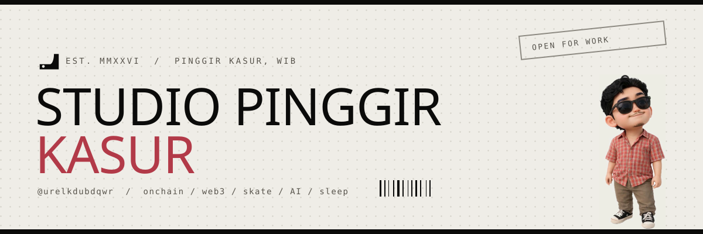
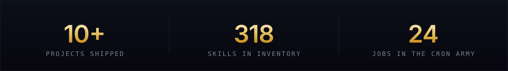
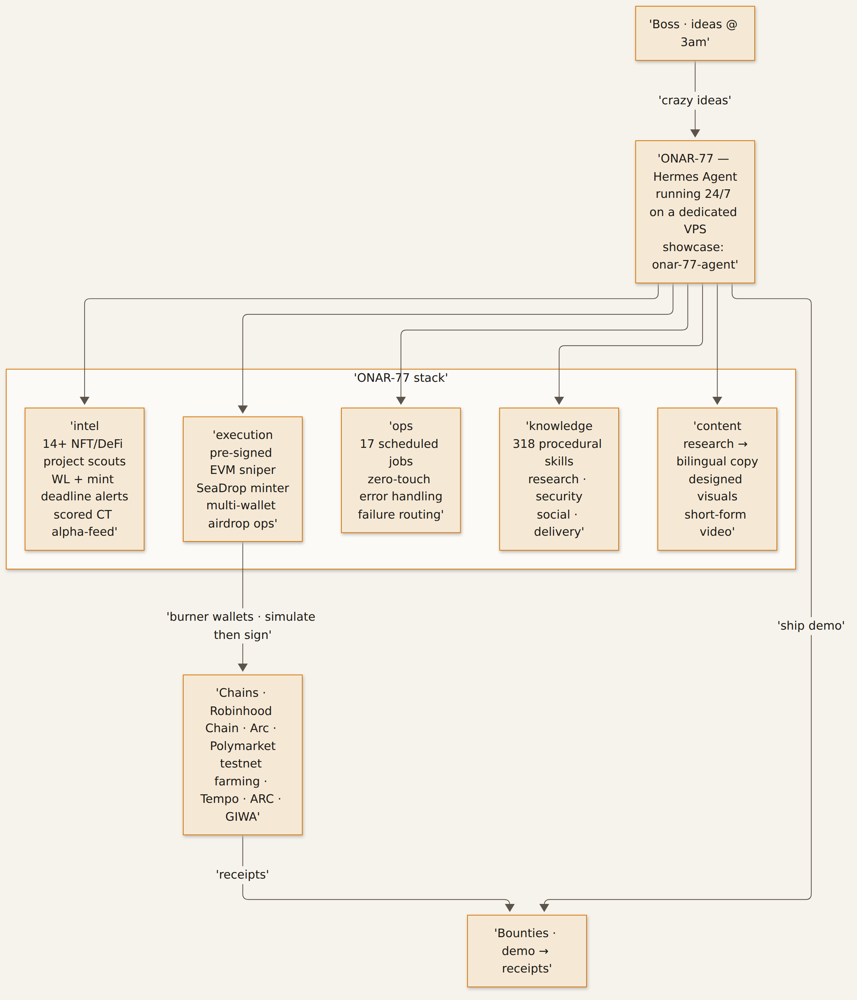

# urelkdubdqwr

**Web3 Business Development · Community Growth · AI Automation Operator · Multi-Cycle OG (active since 2018).** I help Web3 teams grow — BD conversations, community ops (Discord/Telegram/X in EN + ID), campaign execution — with self-built automation handling monitoring, tracking, and content production 24/7 in the background. Human hours go to people and deals.

[](https://github.com/urelkdubdqwr/urelkdubdqwr/actions/workflows/ci.yml) [](LICENSE)





## The one-liner

> ex-HSE Safety Officer (48 months zero-accident, 1,500-headcount site) who went full-time Web3 — now a one-man BD, community, and ops machine, powered by self-built automation. EN/ID bilingual. WIB (UTC+7), 24/7.

## What I do

- **Business development & outreach** — pipeline prep, partner conversations, campaign design for NFT / L1-L2 / DAO / Launchpad / RWA teams.
- **Community growth** — Discord-first + Telegram-first + X-first ops in EN and ID: onboarding, support, educational threads, feedback loops to project teams.
- **AI automation** — self-built agent stack for the boring 80%: project monitors, whitelist & mint deadline watchdogs, alpha-feed intake with scoring, daily briefings, failure routing.
- **On-chain execution** — pre-signed EVM mint sniper, OpenSea/SeaDrop drop minter, multi-wallet airdrop ops, testnet farming programs (Tempo, ARC, GIWA) — all simulated and replayable.

## Flagship — ONAR-77

```text
ONAR-77 · running 24/7 on a dedicated VPS
├── intel      — 14+ NFT/DeFi project scouts · WL/mint deadline alerts · scored CT alpha-feed
├── execution  — pre-signed EVM sniper · SeaDrop minter · multi-wallet airdrop ops
├── ops        — 17 scheduled jobs · zero-touch error handling · failure routing
├── knowledge  — 318 procedural skills (research, security, social, delivery)
└── content    — research → bilingual copy → designed visuals → short-form video
```

Showcase: **[onar-77-agent](https://github.com/urelkdubdqwr/onar-77-agent)** — 318 skills, jaga deadline sambil lo tidur.

## Receipts over promises

- 🧾 **bounties** — shipped demos with receipts: ArmorCodex (First Dollar, Sep 2026), SignalShield (GatewayHacks 2026), usepaid deliverables.
- 📣 **content** — research → bilingual copy → designed visuals → short-form video, end to end (incl. a fully automated 2-min explainer for a firstdollar.money bounty).
- 🤖 **automation** — agent stack covering monitoring, deadlines, and reporting 24/7: [onar-77-agent](https://github.com/urelkdubdqwr/onar-77-agent) (318 skills).

## Projects

| Project | What it be | Stack |
| --- | --- | --- |
| **[browser-anti-oom](https://github.com/urelkdubdqwr/browser-anti-oom)** | on-demand headless browser recipe — no RAM creep, no zombies, no 3 AM OOM kills. | `Bash` `Chromium` |
| **[signalshield](https://github.com/urelkdubdqwr/signalshield)** | paste klaim Web3 → risk signals + evidence gaps. GatewayHacks 2026, submitted + live. | `Python` `LLM tooling` |
| **[onar-77-agent](https://github.com/urelkdubdqwr/onar-77-agent)** | autonomous intelligence + execution agent — scouts, deadlines, content. | `Python` `Hermes Agent` |
| **[bounty-armorcodex](https://github.com/urelkdubdqwr/bounty-armorcodex)** | ArmorCodex demo — intent-based Bash security buat Codex. First Dollar Sep 2026. | `Bash` `OpenAI Codex` |
| **[onar-links](https://github.com/urelkdubdqwr/onar-links)** [live ↗](https://onar-links.vercel.app) | satu pintu ke internet-nya ONAR-77. link hub, auto-deploy. | `HTML` `Vercel` |
| **[onar-77-mintbots](https://github.com/urelkdubdqwr/onar-77-mintbots)** | mint bot squad — pre-signed EVM sniper + station bot. | `Node.js` `ethers` |
| **[dyor-arc-contest](https://github.com/urelkdubdqwr/dyor-arc-contest)** | ARC contest research + submission builds. | `Python` |
| **[bounty-portfolio](https://github.com/urelkdubdqwr/bounty-portfolio)** | bounty demos with receipts — tiap submission ada buktinya. | `Mixed` |

## How the studio runs

- **cron army** — 17 jobs: NFT deadline watchdog, airdrop farms, bounty radar, daily briefings. ada perubahan → ketahuan. aman → diem.
- **sybil-safe ops** — burner wallets, strict secret hygiene, simulate before broadcast. main wallet gak pernah ketemu terminal.
- **ship in public** — tiap bounty = demo jalan + laporan. receipts wajib. 🧾

## Stack

- **automation** — `Python` `Node.js` `cron` `GitHub Actions` · Linux/VPS ops
- **agents** — Hermes Agent · 318 skills, [Agent Skills spec](https://agentskills.io/specification)
- **onchain** — `ethers` `viem` `Foundry` · testnet-first, mainnet cuma sama izin eksplisit
- **trading** — MT5/MQL5 Expert Advisors headless on Linux (Wine) · LLM analyst ensemble research
- **content** — bilingual copy EN/ID · designed visuals · short-form video, end to end

## Currently



*interaktif: [assets/ecosystem.html](assets/ecosystem.html) (dark/light, pan/zoom, trace motion)*

- nginap di Robinhood Chain, Arc, Polymarket
- nge-farm airdrop testnet — pola manusia. robot yang ketahuan = robot gagal.
- bounty masuk → demo keluar → receipts numpuk.


## Background

| | |
| --- | --- |
| 🛡️ **HSE/K3 Safety Officer** — PT Rayon Utama Makmur (2019–2023) | 48 months zero-accident · 95% compliance audit · <1 incident/month on 1,500 headcount |
| 🌐 **Web3 since 2018** | multi-cycle: Arbitrum builder 2021–2023 · contributor across Aptos, Optimism, Base, 1inch, Tokocrypto, GMX, Hyperliquid, dYdX |
| 🎓 **Education** | SMK Bina Patria 1 Sukoharjo — Teknik Pemesinan (2018) · Bankless Academy 101 · Consensys Academy · Alchemy University |

## Find me

| Channel | Handle |
| --- | --- |
| X | [@onargudel](https://x.com/onargudel) |
| Telegram | [@robigudel](https://t.me/robigudel) |
| Discord | `urelkdubdqwr_` |
| X | [@onargudel](https://x.com/onargudel) |
| Link hub | [onar-links.vercel.app](https://onar-links.vercel.app) 📡 |

*Available for Web3/CFD business development & community roles — remote, WIB (UTC+7), 24/7, English + Bahasa Indonesia.*

---

built at **STUDIO PINGGIR KASUR** — where midnight ideas wake up as morning commits. 🛏️ → 💻 → 🚀

🦂 → 🦅 → 🔥
